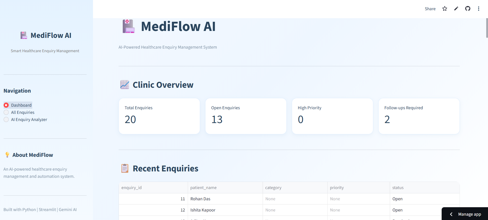
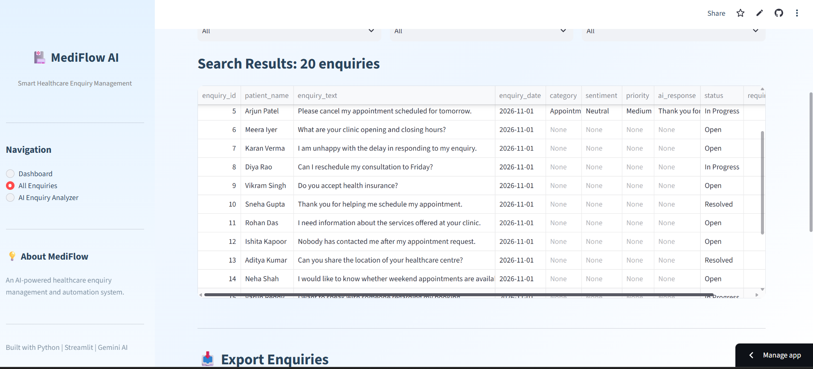

# MediFlow AI 🏥

### AI-Powered Healthcare Enquiry Management & Automation System

MediFlow AI is an intelligent healthcare enquiry management system designed to help clinic administrative teams organise patient enquiries, automate enquiry classification, and generate suggested responses using Generative AI.

The application combines AI-powered text analysis with an interactive dashboard to improve enquiry handling and administrative efficiency.

## ✨ Key Features

* **AI Enquiry Classification:** Automatically categorises enquiries by type, sentiment, and administrative priority.
* **AI Response Generation:** Generates polite, context-aware response drafts for patient enquiries.
* **Interactive Dashboard:** Displays enquiry metrics, category distribution, sentiment analysis, and priority insights.
* **Enquiry Management:** Search, filter, view, and update enquiry statuses.
* **Follow-up Recommendations:** Identifies enquiries that may require administrative follow-up.
* **CSV Export:** Export enquiry records for further analysis.
* **Demo Mode:** Explore the application's core functionality without using an API key.
## 📸 Application Preview

### Dashboard


### Enquiry Management


### AI Enquiry Analysis


### Suggested Response


## 🛠️ Tech Stack

| Technology        | Purpose                         |
| ----------------- | ------------------------------- |
| Python            | Application development         |
| Streamlit         | Interactive web application     |
| Google Gemini API | Generative AI and text analysis |
| Pandas            | Data processing                 |
| Plotly            | Interactive visualisations      |
| SQLite            | Database management             |
| Python-dotenv     | Environment variable management |

## 🏗️ Project Structure

```text
Mediflow AI/
│
├── app.py
├── import_data.py
├── requirements.txt
├── .gitignore
│
├── assets/
│   └── style.css
│
├── database/
│   └── db.py
│
├── data/
│   └── enquiries.csv
│
├── modules/
│   ├── gemini_client.py
│   ├── classifier.py
│   ├── followup.py
│   ├── analytics.py
│   └── demo_mode.py
│
└── utils/
    └── combined_prompt.py
```

## ⚙️ Installation and Setup

### 1. Clone the repository

```bash
git clone YOUR_GITHUB_REPOSITORY_URL
cd "Mediflow AI"
```

### 2. Create a virtual environment

```bash
python -m venv venv
```

### 3. Activate the environment

Windows:

```bash
venv\Scripts\activate
```

### 4. Install dependencies

```bash
pip install -r requirements.txt
```

### 5. Configure the Gemini API key

Create a `.env` file in the project root directory:

```env
GEMINI_API_KEY=your_api_key_here
```

Never upload your actual API key to GitHub.

### 6. Initialise the database

```bash
python import_data.py
```

### 7. Run the application

```bash
streamlit run app.py
```

The application will open in your browser.

##  AI Implementation

MediFlow AI uses Google Gemini to analyse healthcare-related administrative enquiries.

The AI workflow:

1. Accepts a patient enquiry.
2. Classifies the enquiry into a predefined administrative category.
3. Identifies sentiment and administrative priority.
4. Generates a short enquiry summary.
5. Determines whether administrative follow-up is recommended.
6. Drafts a suggested response for staff review.

A combined prompt is used to perform classification and response generation in a single AI request.

##  Responsible AI and Privacy

* Uses fictional synthetic enquiry data for demonstration.
* Does not provide medical diagnoses or treatment recommendations.
* Does not infer clinical urgency from sentiment.
* Flags potentially life-threatening situations for immediate human attention.
* AI-generated responses require human review and approval.
* Does not automatically send messages to patients.

## 🚀 Future Enhancements

* Role-based access control.
* Email integration for enquiry notifications.
* Advanced analytics and reporting.
* Multi-clinic support.
* Enhanced follow-up automation.

##  Author

Developed as an AI-powered healthcare administration project to demonstrate practical applications of Python, Generative AI, prompt engineering, data analytics, and workflow automation.
